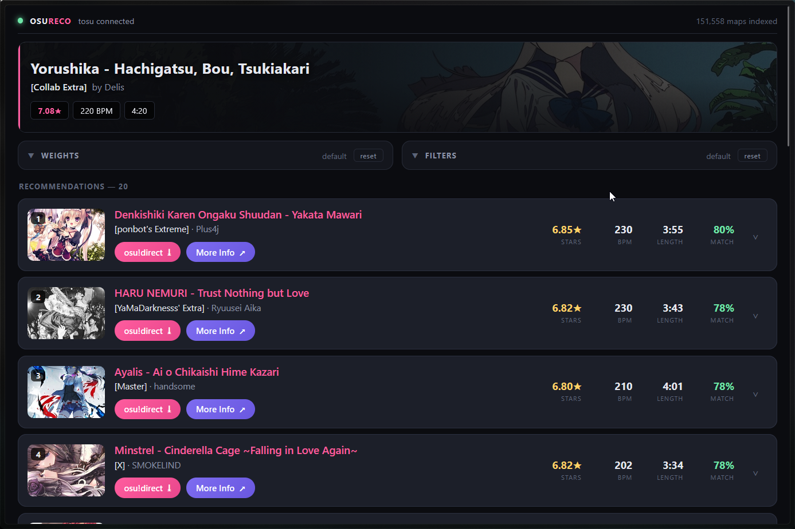
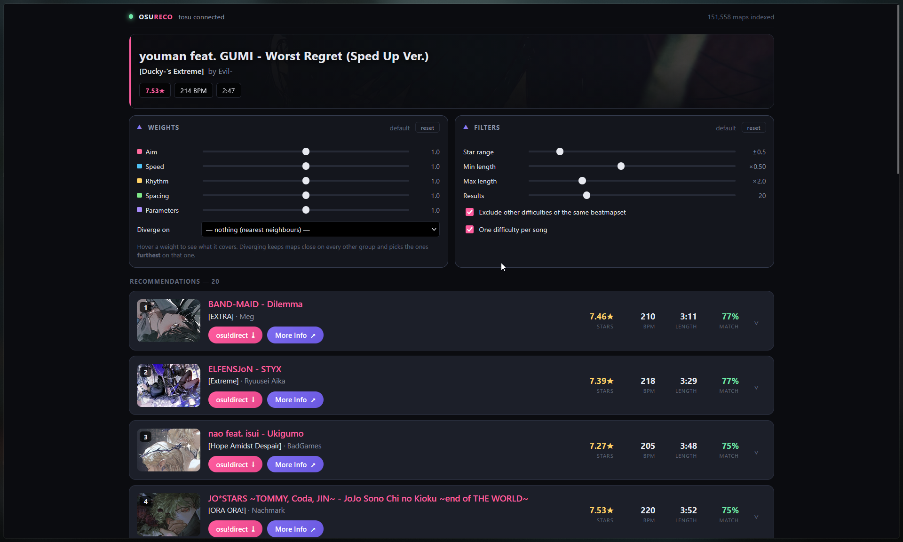

# osu!MapMatcher


**Find the osu! maps that actually play like the one you have selected.**
Pick a map in song select, and this tool shows you the most structurally similar
maps out of 151,558 ranked and loved beatmaps — updating live, on your second
screen, with no account. The search runs on a hosted instance by default, so
there is nothing to download; it can also run entirely on your own machine,
offline, if you prefer.



---

## Built with AI — read this first

**This project was written end-to-end with an AI assistant** (Claude, by
Anthropic, driven through Claude Code). That is not a footnote, so it goes at
the top: essentially every line of Python, CSS and JavaScript in this repository
was generated by a language model.

What a human did: set the goal and the constraints, chose the architecture,
supplied the domain knowledge about osu!, ran the tool against maps they know by
heart, and rejected the results that were wrong. Several design decisions in
here exist *because* a human looked at the output and said it was bad — the mod
handling was rebuilt from scratch after the first version turned out to be
subtly meaningless, and the feature set was cut by 13 columns after measuring
redundancy on real data.

What that means for you:

- **Read the code before trusting it.** It is commented and tested, but it was
  not written by a person who will notice a subtle mistake by intuition.
- **The recommendations are opinions, not truth.** They come from a similarity
  metric someone designed; they are not a community consensus or a ranking.
- If you find something wrong, open an issue. That feedback loop is what made
  the tool work in the first place.

---

## What it does

It reads which map you have selected via [tosu](https://github.com/tosuapp/tosu),
computes a 96-dimension description of that map's *structure*, and finds the
nearest maps in a prebuilt index.

It does **not** use play counts, ratings, favourites or what other people like.
Two maps are close here because they are built the same way — same rhythm
density, same jump geometry, same distribution of hard sections — not because
the same people happen to enjoy both.

Each recommendation shows:

- **Stars, BPM, length** and a **Match %**
- an **osu!direct** button (imports straight into the game) and **More Info**
- an expandable breakdown of *why* it was suggested, in plain English:
  `tighter jumps (5.8r → 4.5r) · slower cursor (30r/s → 22r/s) · same AR`

You can also:

- **Re-weight the five feature groups** (Aim, Speed, Rhythm, Spacing,
  Parameters) to say what "similar" means to you right now
- **Diverge on one group** — keep maps close on everything *except* one skill.
  Same difficulty, opposite challenge. Useful for practice.
- **Pivot**: make any recommendation the new search source without touching the
  game.



Both panels stay collapsed until you need them, and show what you have changed
away from the defaults right in their header.

Mods are handled: turn on DT, HR, DTHR or HT in osu! and the tool switches to a
corpus computed with those mods, so a 7★ map played at 1.5× is compared against
other maps at 1.5×.

## Requirements

- **Windows** (the launcher is a `.bat`; the Python code itself is portable)
- **osu!** (stable)
- **[tosu](https://github.com/tosuapp/tosu)** running on its default port 24050
- **Python 3.11+** — the launcher installs it via `winget` if it is missing
- an internet connection, or ~1 GB of free disk space — see below

## Quick start

1. Download this repository (green **Code** button → *Download ZIP*, or
   `git clone`) and unzip it somewhere permanent.
2. Start **osu!** and **tosu**.
3. Double-click **`start.bat`**.
4. Your browser opens on `http://localhost:8000`. Click a map in song select.

The first run creates a virtual environment and installs the dependencies.
There is nothing else to download: by default the search runs on a hosted
instance, so the first launch takes seconds rather than minutes.

## Where the search runs

The tool always talks to tosu on your own machine — that part cannot move. Only
the search itself has a choice, and the header lets you switch at any time.

| | |
|---|---|
| **server** (default) | Your machine sends the map's checksum; the server answers with the neighbours. Nothing to download, no index on disk. |
| **local** | Everything happens on your machine, offline, once you have an index (~290 MB per mod variant). |

The checksum is all that normally leaves your machine — 32 characters, the same
MD5 osu! itself uses to identify a beatmap. A map the server has never seen (an
unsubmitted or edited map) is the exception: the tool then sends the 96 numbers
it computed locally, or the `.osu` file itself if the server runs a different
version of the feature set.

**If the server is unreachable, the tool falls back to the local index** and
says so in the header — provided you have one. The reverse also holds: local
mode never touches the network.

To get a local index, run `start.bat --mode local`; the launcher downloads the
prebuilt NoMod one from this repository's
[latest release](https://github.com/Ayreth/OsuMapMatcher/releases/latest) (164
MB). If you cloned a fork, it reads your own git remote instead, so your fork
serves your own index with no code change. `OSURECO_INDEX_URL` overrides both.

To point the tool at a different instance, or at none at all:

```bash
start.bat --api https://osureco.example.com    # someone else's server
start.bat --api ""                             # never touch the network
```

`OSURECO_API_URL` and `OSURECO_MODE` do the same thing through the environment.

## Running it by hand

```bash
python -m venv .venv
.venv\Scripts\python.exe -m pip install -e ".[corpus,index,server]"
.venv\Scripts\python.exe -m osureco.launcher
```

Useful flags: `--port 8080`, `--no-browser`, `--mode local`, `--api URL`,
`--build`.

## Building your own index

Only needed for local mode. The prebuilt index covers **NoMod only**; to get the
DT / HR / DTHR / HT corpora as well, or to rebuild from a newer dump, you need
the raw beatmap files:

1. Download a `*_osu_files.tar.bz2` archive from
   [data.ppy.sh](https://data.ppy.sh) (a few GB).
2. Extract it into `data/osu_files/`, or point `OSURECO_DUMP` at wherever you
   put it. The archive nests several folders of the same name; the tool finds
   the right level on its own.
3. Build:

```bash
.venv\Scripts\python.exe scripts\build_all.py
```

About 2 minutes per mod variant on 24 cores, ~1.5 GB on disk for all five.
It is interruptible: run the same command again and it picks up where it left
off. `--variants nomod,DT` limits which ones get built.

## Running it as a service (optional)

The engine can also run as a plain HTTP API, so a client does not have to
install Python or download the index. That is what makes a browser-only client
possible — a [tosu counter](https://github.com/tosuapp/counters) is a static
page and cannot host a backend.

```bash
pip install -e ".[api]"
python -m osureco.api --host 0.0.0.0 --port 8080 --fetch
```

A client can ask in three ways: by checksum (the map is already in the corpus,
zero CPU), by sending a feature dict it computed itself, or by posting the raw
`.osu` and letting the server featurise it. The last one costs nothing either
when the map is known, since a map's checksum *is* the MD5 of its `.osu`.

- HTTP contract, with client recipes: [`docs/API.md`](docs/API.md)
- Deploying it (Docker, systemd, TLS, sizing): [`deploy/README.md`](deploy/README.md)

**The API is never required.** The desktop tool runs entirely offline against
its own index, and that stays the default and the fallback — a tool that stops
working because someone else's server went down is exactly what this project
set out not to be.

## How the similarity works

Every map is reduced to 96 numbers in five groups:

| Group | What it captures |
|---|---|
| **Aim** | Cursor movement load and how much it spikes, from rosu-pp's aim strains |
| **Speed** | Tapping load, stream density, how it is spread across the map |
| **Rhythm** | BPM, BPM changes, gaps between objects, stream vs. spaced patterns |
| **Spacing** | Distances normalised by circle radius, angle histogram, required velocity |
| **Parameters** | CS, AR, OD, HP, slider ratio, object count, length, density |

Difficulty and strain values come from
[rosu-pp](https://github.com/MaxOhn/rosu-pp) — the same engine tosu uses, so the
numbers line up with what the game shows. The geometry is parsed directly from
the `.osu` files.

Those 96 columns are scaled with a `RobustScaler` over the 5th–95th percentile
range and clipped, then compared with a weighted Euclidean distance. The scaling
matters more than the search does: on raw features, a column measured in tens of
thousands silently drowns out a column measured in units, and the distance
collapses onto two or three dimensions. Star rating is deliberately *not* part
of the vector — it is a filter, not a dimension of similarity.

Search is a pre-filter (star band, length ratio, exclude the same beatmapset)
followed by exact weighted scoring over the survivors, with a
[usearch](https://github.com/unum-cloud/usearch) HNSW index taking over when the
filter leaves too many candidates. The filter runs over in-memory columns rather
than in SQL: the same conditions in SQLite cost 250 ms on a dense star band,
because finding the rows by star rating is fast but testing the other columns
means reading 30,000 rows one at a time. Typical query now: ~10 ms.

## Limitations

- **osu!standard only.** Taiko, catch and mania maps are skipped (35% of the
  dump).
- **Ranked and loved only.** The ppy dump does not include graveyard or WIP
  maps, so those will never be recommended.
- **EZ, FL and HT+HR have no dedicated corpus** and fall back to the closest one
  available. Mods that change difficulty numbers without moving objects or the
  clock — HD, FL, NF and friends — are deliberately ignored on *both* sides of
  the comparison, so query and corpus stay consistent; their effect simply is
  not modelled. (Measured: HD shifts the flashlight strain series by ~30%, FL
  does not touch it at all.)
- **Slider shapes are ignored.** Only object start positions are read — no curve
  types, no repeats, no slider velocity. A map with wild slider art and a plain
  one can look similar here.
- **Beatmap thumbnails** are the only thing loaded from the network at runtime
  (`assets.ppy.sh`). Everything else is local; offline, you just lose the images.

## Not affiliated

This is a fan project. It is not affiliated with or endorsed by ppy Pty Ltd.
Beatmap data comes from the public dumps at [data.ppy.sh](https://data.ppy.sh);
all beatmaps belong to their respective creators.

The name is a nod to the original, now-defunct `OsuMapMatcher`. This is not a
fork of it — no code is shared, and the approach is different.

## License

MIT. See [LICENSE](LICENSE).
